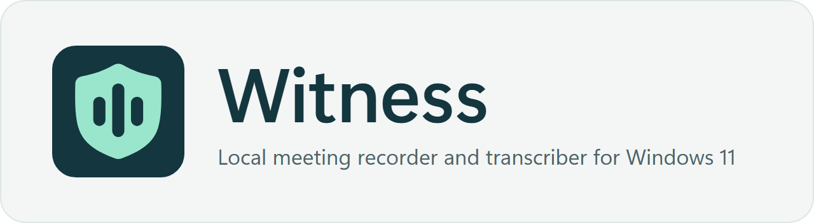

<h1>
  <picture>
    <source media="(prefers-color-scheme: dark)" srcset="assets/brand/witness-banner-dark.png">
    
  </picture>
</h1>

Witness is a local meeting recorder and transcriber for Windows 11, written
as a single native Rust app. It can detect Microsoft Teams calls, capture
microphone and system output on separate tracks, transcribe on the device,
identify recurring speakers, and keep a searchable archive.

Meeting audio, transcripts, notes, and voice prints are not sent to a Witness
service. Choosing **Download** for a speech model connects to Hugging Face;
downloading the GPU libraries connects to PyPI's `files.pythonhosted.org` host
for pinned NVIDIA-published wheels; the update check (on by default, switchable
under **Settings > About**) and installing an update connect to GitHub. No
meeting content is included in those requests. The optional AI assistant (off
by default) is the one feature that sends meeting text — transcript, speaker
names and title, never audio — and only to the OpenAI-compatible service you
configure, which can be a server on your own computer. See
[Privacy](PRIVACY.md) before recording other people.

> Witness is pre-1.0 software. Test it with non-critical recordings and keep
> independent backups of anything you cannot replace.

## What it does

- Automatically starts and stops around Teams calls, or records manually.
- Captures the selected microphone and render-device loopback as two tracks.
  Loopback includes every sound sent to that output device, including music and
  notifications. Route Teams to a dedicated output device if isolation matters.
- Produces a stereo Ogg Opus archive, normally around 18 MB per hour at the
  default bitrate.
- Runs Parakeet TDT or Whisper transcription locally. Parakeet supports live
  captions, in the app and in an always-on-top overlay; the final transcript
  replaces those provisional captions.
- Global hotkeys start/stop recording (Ctrl+Alt+R) and drop bookmarks
  (Ctrl+Alt+B), with fallbacks if another app owns those combinations.
- Diarizes up to eight remote speakers and stores explicit speaker enrollments
  as local voice-print embeddings. A People view shows each person's speaking
  time across meetings and a 12-week trend.
- Searches transcript text and notes with SQLite FTS5, and exports
  transcripts as Markdown, plain text, SRT, or WebVTT.
- Recovers interrupted recordings and queued processing after a restart.
- Moves deleted meetings to a recycle bin before permanent deletion.
- Creates atomic, checksummed recovery snapshots from Settings.
- Optional, off by default: an AI assistant that titles meetings and writes
  their notes (summary, key points, decisions, action items) through any
  OpenAI-compatible API — OpenAI, or a local server such as Ollama or LM
  Studio. On request from the transcript (or Ctrl+K), or automatically after
  each transcription if you turn that on; it never replaces a title you
  typed. The API key is kept in Windows Credential Manager.

## Install and first run

Witness currently targets Windows 11. Download `Witness_<version>_x64-setup.exe`
from [Releases](https://github.com/CubityFirst/Witness/releases) — a per-user
install that needs no administrator rights — start Witness, and leave its tray
process running. Closing the main window hides it; use **Quit** from the tray
to exit. Installed copies check GitHub for signed updates; installing one is
always a click in **Settings > About** and is refused while recording.

Before an important call:

1. Open **Settings > Recording** and select the intended microphone and output
   device. Saved endpoint IDs are strict: if a configured device is missing,
   Witness reports it instead of silently recording another device.
2. Make a short manual test recording and play both sides back.
3. Download the desired models under **Settings > Storage**.
4. Confirm local rules and participant consent allow recording.

Recording works without models; transcription, diarization, voice matching,
and live captions require their corresponding downloads. A tray notification
announces automatic recording. The top bar and Diagnostics show capture loss
or device failures.

## Models, network access, and disk space

Model downloads are explicit and pinned to immutable upstream revisions. Each
file is size- and checksum-verified before it is considered installed. A failed
or interrupted download remains incomplete and can be repaired from Settings.

| Capability | Model | Approximate disk use |
| --- | --- | ---: |
| Fast ASR and live captions | Parakeet TDT 0.6B v3 | 2.6 GB |
| Remote-speaker diarization (up to 8) | NVIDIA Nemotron 3 Diarization | 400 MB |
| Cross-meeting speaker matching | ERes2Net | 26 MB |
| Alternate ASR | Whisper large-v3-turbo q5 | 575 MB |

Allow at least 5 GB free when installing every model so downloads and temporary
files have headroom. **Settings > Storage > Delete model cache** frees that
space again (refused while recording, transcribing, or downloading). Parakeet
attempts NVIDIA CUDA and falls back to CPU if the provider cannot initialize.
GPU transcription needs the CUDA 13 runtime and cuDNN 9 resolvable by the DLL
loader; Witness checks this before every engine load, automatically picks up
installs referenced by `CUDNN_PATH` or placed in the standard `NVIDIA\CUDNN`
layout (under Program Files or LOCALAPPDATA), and otherwise logs which DLLs are
missing. Settings shows the same GPU status.

Machines with an NVIDIA GPU but no CUDA developer install can use **Settings >
Transcription > GPU libraries > Download** (~1 GB): Witness fetches the pinned,
SHA-256-verified NVIDIA-published CUDA runtime, cuDNN, and nvJitLink wheels
hosted by PyPI (`files.pythonhosted.org`) and installs just the required DLLs
into the data directory — no admin rights, no system changes, removable by
deleting `cuda/`. GPU transcription can use the new libraries immediately,
without a restart.

Whisper is CPU-only in the default build. Model revision and integrity status
appears in Settings and the privacy-safe diagnostic report.

## Storage and retention

`witness-settings.toml` is read from `WITNESS_SETTINGS` (a file, or a directory
containing the default file) when set, otherwise from beside `witness.exe`.
The configured data directory contains:

```text
witness.db       transcripts, notes, queue state, and voice prints
audio/           archived .opus recordings
rec-tmp/         in-flight/recoverable WAV files and sidecars
models/          downloaded model cache and integrity metadata
cuda/            optional app-managed CUDA/cuDNN/nvJitLink GPU libraries
witness.log      rotating operational log
```

Changing the data directory applies after restart and does not move existing
data. Deleted meetings remain in the recycle bin for 30 days, then are purged
at startup. Emptying the bin is immediate and irreversible. Backups are
independent copies and are not affected by retention actions in the app.

The database, audio, settings, logs, and backups are not encrypted by Witness.
Use Windows device encryption/BitLocker and an account with a strong sign-in if
the archive is sensitive.

## Backups and recovery

Use **Settings > Storage > Create backup** while recording and processing are
idle. Witness writes into a private staging directory and publishes a
`Witness-backup-...` directory only after every payload and its checksum
manifest is complete. The snapshot includes:

- a consistent standalone `witness.db` snapshot, including transcripts, notes,
  recycle-bin state, queue state, and voice prints;
- archived audio and recoverable `rec-tmp` files;
- the persisted settings; and
- model revision/integrity metadata.

Large model binaries are intentionally excluded and can be re-downloaded.
Never choose a destination inside the active Witness data directory. Full
verification and non-destructive restore instructions are in
[Backup and recovery](docs/BACKUP_AND_RECOVERY.md).

## Diagnostics and troubleshooting

Open **Settings > About > Diagnostics** to inspect the active data/database/log paths,
SQLite health, capture loss, processing stage, queue depth, and model integrity.
The copied/exported support report contains operational state and local paths,
but no transcript text, notes, audio, voice prints, or private settings. Review
paths before sharing it.

Common problems:

- **Configured audio device missing:** reconnect it or deliberately choose a
  new endpoint in Settings. Witness will not silently fall back.
- **Output track is silent:** confirm Teams is routed to the output device that
  Witness captures. Per-process loopback is not used because it is unreliable
  for Teams.
- **Unrelated audio was recorded:** loopback captures the complete selected
  output device. Route Teams to a dedicated virtual or hardware channel.
- **Recording shows dropped time/device losses:** preserve the recording, export
  Diagnostics, and check USB/Bluetooth power, drivers, and device changes.
- **Transcription is unexpectedly slow:** check the GPU line in Settings and
  `witness.log` — a warning names any CUDA/cuDNN DLLs the loader cannot find,
  and a single-digit realtime factor in completion toasts means CPU. Use
  **GPU libraries > Download** in Settings > Transcription (or install cuDNN 9 for
  CUDA 13 / set `CUDNN_PATH`) to restore GPU transcription. CPU fallback is
  functional but slower.
- **Model integrity check failed:** use **Repair** in Settings. Witness will not
  load a model until the pinned files verify.
- **Meeting remains failed:** keep its `rec-tmp` files and use Retranscribe. Do
  not purge the meeting until recovery succeeds.
- **New data directory appears empty:** the selection does not migrate data.
  Return to the old directory or follow the recovery guide.

## Build from source

Witness is a pure Rust Cargo workspace: `crates/witness-core` (the backend
library), `crates/witness` (the native egui app, `witness.exe`) and `xtask`
(build, signing and release tooling). No Node.js, npm, or WebView2 is needed.

Requirements:

- Rust with the MSVC target (the toolchain is pinned in
  `rust-toolchain.toml`; rustup installs it on first use);
- Visual Studio Build Tools with Desktop C++ and CMake; and
- LLVM/libclang 19.x for bindgen. Put CMake on `PATH` and set
  `LIBCLANG_PATH` to your LLVM `bin` directory when it is not discoverable.
  Do not rely on machine-specific paths in repository configuration.

```powershell
cargo test --workspace --locked
cargo clippy --workspace --locked --all-targets -- -D warnings
cargo run -p witness
```

Build the NSIS installer with `cargo run -p xtask -- dist`. It compiles the
release `witness.exe`, verifies its version resource and that both ONNX
Runtime provider DLLs were produced next to it, fetches the pinned NSIS
toolchain (SHA-256 verified) into `%LOCALAPPDATA%\witness-build`, and writes
`Witness_<version>_x64-setup.exe` under `<target>\release\bundle\nsis\`.
`cargo run -p xtask -- help` lists the other release commands.

The default Whisper build uses CPU; `--features witness-core/whisper-cuda`
requires a compatible CUDA toolkit. Runtime CUDA support for
Parakeet also needs a compatible NVIDIA driver and cuDNN 9.

See [Contributing](CONTRIBUTING.md) and the
[release checklist](docs/RELEASE_CHECKLIST.md) before proposing a change or
shipping an artifact.

## Limitations

- Windows 11 only; Teams is the only built-in auto-detection target.
- No echo cancellation. Speakers can bleed remote audio into the microphone
  track; a headset is recommended.
- Diarization supports at most eight remote speakers.
- Voice matching is probabilistic. Approximate matches are marked and should be
  confirmed or corrected.
- Live captions are provisional; the final transcript replaces them.
- No application-level encryption or cloud synchronization.

## Security and license

Report vulnerabilities as described in [SECURITY.md](SECURITY.md). Witness is
released under the [MIT License](LICENSE).
